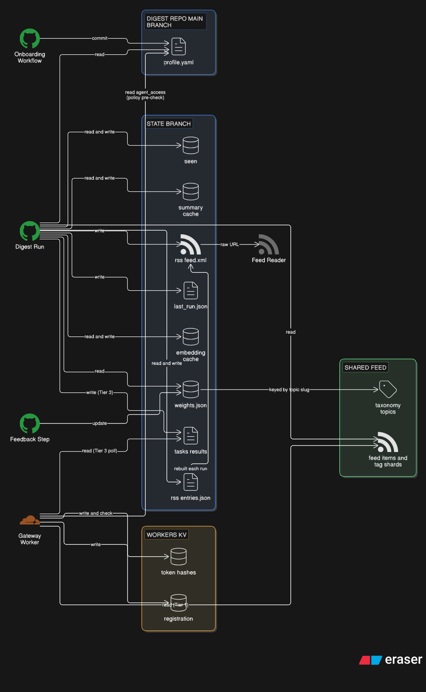

# Axon architecture (overview)

Axon is a **Git-native, bring-your-own-key (BYOK) digest of the AI community**. It collects updates
from a fixed set of vetted sources, ranks and deduplicates them in a shared feed that uses **no LLM**,
then summarises them with **your own** key and delivers a personal digest. The same capability is
offered to other agents over **A2A** and **MCP**.

This file is the map. Each code repository has its own `ARCHITECTURE.md` with the detail.
The authoritative specification is `docs/axon-architecture.md` (v1.7 plus the Appendix C items that
record later decisions). Where this file and the spec differ, the spec wins.

## The four repositories

| Repo | Role | Language | Runs on |
|---|---|---|---|
| [`Axon`](https://github.com/gowthamsai09/Axon) (this hub) | Spec, JSON schemas, canonical prompts, hostile-input corpora, operational docs | Markdown, Python tests | CI only |
| [`axon-feed`](https://github.com/gowthamsai09/axon-feed) | Plane 1: shared, LLM-free feed | Python 3.12 | GitHub Actions + Pages |
| [`axon-template`](https://github.com/gowthamsai09/axon-template) | Plane 2: per-user pipeline (you create your private repo from it) | Python 3.12 | GitHub Actions |
| [`axon-gateway`](https://github.com/gowthamsai09/axon-gateway) | Plane 3: A2A and MCP front door | TypeScript (Hono, zod, jose) | Cloudflare Workers + KV |

All four are public and Apache-2.0. A user's own repository (for example `axon-digest`) is **private**.

## Three planes


1. **Plane 1, shared feed (no LLM).** `collect.yml` runs every 3 hours (`7 */3 * * *`), collects from the
   vetted sources, canonicalises URLs, deduplicates, tags and scores, and publishes JSON to the `data`
   branch, served by GitHub Pages under `/feed/`. It costs nothing per user and holds no user data.
2. **Plane 2, per-user pipeline.** A private repo made from the template runs `digest.yml` on the owner's
   schedule. It reads the shared feed, ranks by the owner's profile, summarises the top items with the
   owner's key, and delivers by email, Telegram, Slack or an Atom file. State lives on an orphan `state` branch.
3. **Plane 3, gateway.** A Cloudflare Worker serves the shared feed to agents (Tier 1), summarises with
   the caller's own key (Tier 2) and starts the owner's digest through a GitHub App (Tier 3).

Why this split: the expensive, shared work (collecting and ranking) happens once for everybody and
needs no secrets; everything that needs a key happens either in the owner's repo or in memory for one
request.

## Tiers

| Tier | Plane | Key used | Stored by Axon |
|---|---|---|---|
| 1 data | Gateway reads the shared feed | none | nothing |
| 2 summary | Gateway summarises feed items | caller's, header only | nothing (memory, one request) |
| 3 digest | Gateway dispatches the owner's workflow | owner's, in owner's repo secrets | token hash and repo registration only |

## One request, three ways



The diagram shows what each part stores and where. Summary:

| Where | What | Who can read it |
|---|---|---|
| `axon-feed` `data` branch (public Pages) | Items, tag and entity shards, `meta.json` | Everyone |
| User repo `state` branch (private) | `seen`, `delivered.json`, summary cache, `weights.json`, `rss/feed.xml`, `tasks/<id>.json`, `last_run.json` | The repo owner |
| User repo secrets (private) | LLM key, channel credentials | GitHub Actions at run time |
| Gateway KV | `repo:<owner/name>` registration, `tok:<sha256>` token record, `tokid:...` index | The Worker |
| Gateway secrets | GitHub App private key (type Secret) | The Worker |
| Nowhere | Caller keys in Tier 2 | Memory for one request |

## How the digest is built

1. **Collect** from the vetted sources (arXiv cs.AI, cs.CL, cs.LG; Hugging Face blog and daily papers;
   Hacker News via Algolia; OpenAI news; Google DeepMind blog; GitHub releases of ollama, llama.cpp,
   vllm, langchain, llama_index and transformers).
2. **Canonicalise and dedupe** so one story from three places becomes one item with a cluster size.
3. **Tag** with 16 topics and about 29 entities.
4. **Score** in the feed: `base_score = 0.40 recency + 0.25 authority + 0.20 engagement + 0.15 cluster size`.
5. **Personalise** in the user repo: `user_score = base_score + 0.50 interest_match - 0.50 exclusion_penalty`
   (plus optional embedding and feedback terms, both zero when off).
6. **Summarise** the top N through a router: primary provider, circuit breaker after 3 failures,
   fallback provider, then an extractive snippet as the last resort.
7. **Validate** every summary: shape, length caps, only the source URL, figures present in the source.
8. **Deliver** and record what was sent so a rerun does not repeat items.

Cache key for a summary: `sha256(content_hash | provider | model | depth | language | prompt_version)`.
Changing the prompt version invalidates the cache, which keeps runs deterministic.

## Protocols

| | A2A | MCP |
|---|---|---|
| Version | 0.3.0 (v1.0 has shipped; migration is a recorded open item) | 2026-07-28 primary, 2025-11-25 legacy |
| Transport | JSON-RPC over HTTPS `POST /a2a` | Streamable HTTP, stateless, `POST /mcp` |
| Discovery | `/.well-known/agent-card.json` | `server/discover`, `tools/list` |
| Calls | `message/send`, `tasks/get`, `tasks/cancel` | `tools/call` |
| Not supported | streaming, resubscribe, push | sessions, `initialize` in the modern revision |

Both are thin adapters over one core contract, so a behaviour change is made once. How to call them:
[docs/call-the-agent.md](docs/call-the-agent.md).

## Security model (spec section 10)

- **Untrusted by default.** Scraped content and inbound agent messages are data, never instructions,
  URLs to fetch, shell commands or workflow inputs without validation.
- **Keys.** No operator-held user keys, ever. Tier 2 keys are header-only, memory-only, never logged or
  echoed. A key-shaped value in a request body is refused. Observability is disabled on the Worker.
- **SSRF.** Fixed provider hosts; user-supplied URLs go through a guard that refuses private ranges.
- **Prompt injection.** The summarizer prompt (`p-56a22986b1`) is pinned byte-identical in the template,
  gateway and hub, and checked in CI. Summaries are validated; a model that flags injection is reported.
- **Workflows.** Least-privilege `permissions:`, inputs through `env:` only, third-party actions pinned to
  commit SHAs, template-repo guard, `id-token: write` only in the three registration workflows.
- **Tier 3 identity.** GitHub OIDC (RS256, issuer, audience, expiry and repository claims verified),
  GitHub App installation tokens scoped to the one repo, owner tokens stored only as SHA-256.
- **Tests.** Shared hostile corpora in `corpus/` (injection, SSRF, hostile text) run in both code repos;
  mutation sanity checks prove the security tests fail when a rule is removed.

## Free-tier footprint

Everything runs on free plans: GitHub Actions and Pages, Cloudflare Workers and KV. The only variable
cost is the user's own LLM key, observed at under 0.01 USD for two digest runs. Cloudflare free-plan
limits recorded in the spec (Appendix B item 47, 2026-10-25): 100,000 requests per day, 10 ms CPU per
request, 50 subrequests per request, KV 100,000 reads and 1,000 writes per day. These are third-party
or point-in-time figures: re-check them against Cloudflare's current documentation before quoting them.

## What is verified live and what is not

| Area | State |
|---|---|
| Shared feed collect and Pages | **Verified live** |
| Telegram, Slack, email, Issue-form onboarding | **Verified live** |
| Feedback links and weights, Atom channel, keepalive | **Verified live** |
| Gateway deploy, Tier 1 and Tier 2 (one real call) | **Verified live** |
| Tier 3 over A2A (register, token, start, poll, cancel, revoke) | **Verified live** (2026-11-28) |
| Tier 3 over MCP; a real third-party A2A or MCP client | Not run |
| Weekly trends, embeddings, stale-source Issues, live evals, failure notice | Mocked only |
| CPU p99, per-request subrequests, KV usage per request | Not measured (median CPU about 4.6 ms observed) |

## Repository map

```
Axon/ (hub)
  docs/ axon-architecture.md  axon-STATE.md  axon-GUIDELINES.md  features.md  onboarding.md ...
  schemas/    JSON Schemas exported from the code
  prompts/    canonical summarizer and onboarding prompts
  corpus/     injection, ssrf, hostile-text
  scripts/    prompt id, corpus generators, Action pin checker
axon-feed/        collectors/ pipeline/ config/ scripts/ .github/workflows/collect.yml
axon-template/    digest/ evals/ profile.yaml .github/workflows/{digest,onboard,register,issue-token,revoke-token,keepalive,ci}.yml
axon-gateway/     src/ prompts/ scripts/ test/ wrangler.toml .github/workflows/{ci,deploy}.yml
```

## Further reading

- [Getting started](docs/getting-started.md)
- [Call Axon from an agent](docs/call-the-agent.md)
- [Optional features](docs/features.md)
- Per-repo architecture: `axon-feed/ARCHITECTURE.md`, `axon-template/ARCHITECTURE.md`, `axon-gateway/ARCHITECTURE.md`
