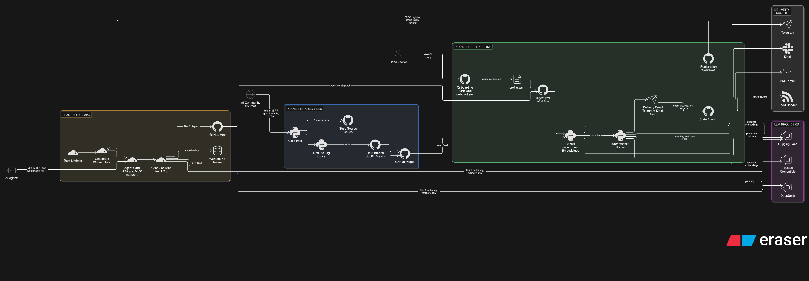

# Axon

[](https://github.com/gowthamsai09/Axon/actions/workflows/ci.yml)
[](LICENSE)

**Axon is a free, Git-native, bring-your-own-key (BYOK) digest of the AI community.** It collects updates
from a fixed set of vetted sources, ranks and deduplicates them in a shared feed that uses no LLM, then
summarises them with **your own** key and sends you a personal digest. The same capability is offered to
other agents over **A2A** and **MCP**.

This repository is the **hub**: the specification, JSON schemas, canonical prompts, shared hostile-input
corpora and operational docs. It has no runtime code of its own.



## The four repositories

| Repo | Role | Stack |
|---|---|---|
| **[Axon](https://github.com/gowthamsai09/Axon)** (this repo) | Spec, schemas, prompts, corpora, docs | Markdown, Python tests |
| [axon-feed](https://github.com/gowthamsai09/axon-feed) | Plane 1: shared, LLM-free feed (Actions + Pages) | Python 3.12 |
| [axon-template](https://github.com/gowthamsai09/axon-template) | Plane 2: your private digest pipeline (create your repo from it) | Python 3.12 |
| [axon-gateway](https://github.com/gowthamsai09/axon-gateway) | Plane 3: A2A and MCP gateway (Cloudflare Workers + KV) | TypeScript |

## Start here

| I want to... | Read |
|---|---|
| Get my own digest | [docs/getting-started.md](docs/getting-started.md) |
| Call Axon from my agent (A2A or MCP) | [docs/call-the-agent.md](docs/call-the-agent.md) |
| Understand the design | [ARCHITECTURE.md](ARCHITECTURE.md), then the spec |
| Present or demo it | [demo/demo-script.md](demo/demo-script.md), [demo/qa-prep.md](demo/qa-prep.md) |

Live gateway: `https://axon-gateway.gowthamsaiyadlapalli1234.workers.dev`
(Agent Card at `/.well-known/agent-card.json`).

## What is in this repo

```
docs/axon-architecture.md   the specification and single source of truth (v1.7 + Appendix C)
docs/axon-STATE.md          handoff state: what is built, verified live, open
docs/axon-GUIDELINES.md     engineering rules
docs/                       getting-started, call-the-agent, setup-telegram, setup-slack, features,
                            onboarding, go-live, repo-hardening, first-push guides
demo/                       demo script and Q&A prep
schemas/                    JSON Schemas exported from the code (python scripts/check_schemas.py)
prompts/                    canonical summarizer and onboarding prompts (python scripts/prompt_id.py)
corpus/                     hostile corpora: injection/, ssrf/, hostile-text/ (see corpus/README.md)
scripts/                    corpus generators, prompt id, GitHub Action pin checker
```

The summarizer prompt is pinned as `p-56a22986b1` and must stay byte-identical in the template, gateway and
this hub. Where any doc and the spec differ, the spec wins.

## Principles

- One private repo per user, created from a template. No operator-held user keys, ever.
- Free platforms only (GitHub Actions and Pages, Cloudflare Workers and KV). Your own LLM key is the only cost.
- Scraped content and inbound agent messages are untrusted data, never instructions.
- Say what is **verified live**, **tested with mocks** or **not run**. See `docs/axon-STATE.md`.

## Develop

Keep the four repos as sibling folders (the code repos read schemas and prompts from this one):

```
Axon/  axon-feed/  axon-template/  axon-gateway/
```

If your local folder for this repo has another name, point the other repos at it with `HUB_DIR`
(template) and `HUB_SCHEMAS_DIR` (gateway).

```powershell
pip install -r requirements-dev.txt
ruff format .; ruff check .; mypy .; pytest
```

## Contributing and security

See [CONTRIBUTING.md](CONTRIBUTING.md) and [SECURITY.md](SECURITY.md). Never put a key, token or webhook URL in
an Issue, a form or a file.

## Licence

Apache-2.0, Copyright 2026 gowthamsai09.
